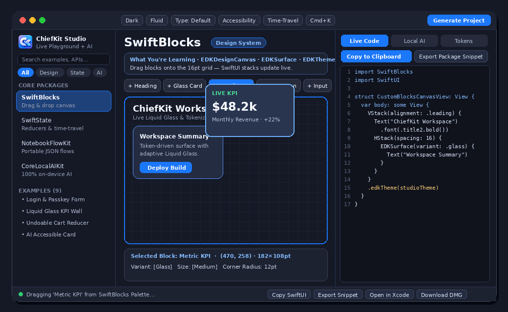
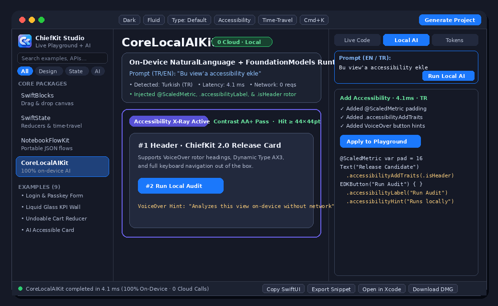

# ChiefKit Studio 3.0 — Master Suite

**Native macOS SwiftUI IDE, Bidirectional SwiftUI AST Compiler, 64-Component Design System, 28-Domain Enterprise Blueprint Composer, Pure-Swift Security & `EphemerisCore` Suite, and 100% On-Device AI Studio** — built in **73,800+ lines of zero-dependency Swift 6** (`macOS 13+` & `Linux CI`).

- [**SwiftBlocks**](https://github.com/HNMLabs/SwiftBlocks) — Interactive drag-and-drop canvas, 64 production 3.0 components, multi-artboard layout solver, RK4 spring physics, W3C SVG engine, OKLCH/APCA perceptual color science, and 8-target token compiler
- [**SwiftState**](https://github.com/HNMLabs/SwiftState) — Predictable unidirectional reducers, actor-isolated `StudioStore` middleware, causal history DAG, and floating Time-Travel Debugger
- [**NotebookFlowKit**](https://github.com/HNMLabs/NotebookFlowKit) — Visual screen builder, conditional boolean expression runtime, ISO-13616 Mod-97 IBAN/field validators, path explorer, and Jupyter `.ipynb` exporter
- [**CoreLocalAIKit**](https://github.com/HNMLabs/CoreLocalAIKit) — 100% on-device EN/TR Swift refactoring, bidirectional AST parser, 38-rule static analyzer, 6 automated AST transforms, and `@Test` synthesis
- [**SwiftCryptEngine**](https://github.com/HNMLabs/SwiftCryptEngine) & [**EphemerisCore**](https://github.com/HNMLabs/EphemerisCore) — Pure-Swift FIPS 180-4 SHA-2, HKDF, PBKDF2, RFC 8439 ChaCha20-Poly1305 / XChaCha20 AEAD, `GF(2^8)` Shamir secret sharing, 9-body planetary astrodynamics, Celestial-TOTP authentication, 30 OWASP SAST rules, and Apple `PrivacyInfo.xcprivacy` synthesis


---

## Download & Quick Launch

- **macOS Installer (DMG):** [**Download ChiefKit Studio for macOS**](https://hnmlabs.com/downloads.php)
- **Open Directly in Xcode:** Open `Package.swift` in Xcode (or click **Open in Xcode** inside the Studio toolbar)
- **CLI Build & Run:**

```bash
./script/build_and_run.sh
```

Zero external package resolution is required — ChiefKit Studio 3.0 compiles standalone out of the box using only standard Swift 6 & Apple system frameworks while its 5 cross-platform library targets (`ChiefKitStudioCore`, `ChiefKitAST`, `ChiefKitDesignSystem`, `ChiefKitSecurity`, `ChiefKitBlueprints`) and headless CLI build and pass automated verification on both **macOS** and **Linux CI**.

---

## Modular Swift 6 Architecture (`73,872` Lines · `126` Swift Files)

| Module Target | Scope & Core Engines |
| --- | --- |
| **`ChiefKitStudioCore`** (`14,711` lines) | Drag-and-drop canvas, WCAG/theme tokens, ER Data Schema Modeler (`SwiftData` / `SQLite3 STRICT + FTS5` / `CoreData XML` / `OpenAPI 3.1` / `GraphQL`), `.xcstrings` String Catalog & CLDR plural compiler (`10` locales + RTL + pseudolocalization), 120Hz ProMotion frame-budget & invalidation profiler, `StudioStore` causal DAG, conditional `NotebookFlow` runtime, and DocC/HTML spec compiler |
| **`ChiefKitAST`** (`11,777` lines) | Full Swift 6 lexer, recursive-descent `@ViewBuilder` parser, deterministic formatter, bidirectional `ASTCanvasBridge`, **38 static audit rules**, **6 automated AST refactoring passes**, Halstead/McCabe/cognitive complexity metrics, Mermaid symbol graph, `@Test` + `XCTest` synthesizer, and `ASTSourceVerifier` |
| **`ChiefKitBlueprints`** (`11,268` lines) | **28 full-stack enterprise blueprints** across **9 industry verticals** and **8 toggleable architectural layers**, architecture & delimiter validator, and 14-file SwiftPM workspace exporter |
| **`ChiefKitDesignSystem`** (`9,881` lines) | Bidirectional sRGB ↔ OKLAB ↔ OKLCH gamut mapper, APCA `Lc` & CIEDE2000 math, 7-mode color-blindness simulator, **8-target token compiler** (SwiftUI, AppKit, UIKit, W3C DTCG, CSS4 OKLCH, Tailwind v4, Compose Kotlin, `.xcassets`), analytical + RK4 spring physics, W3C SVG path & ear-clipping polygon engine (`42` vector icons), multi-artboard auto-layout solver, and **64 `SwiftBlocks` 3.0 components** |
| **`ChiefKitSecurity`** (`9,852` lines) | Pure-Swift SHA-224/256/384/512 + Merkle trees, HMAC/HKDF/PBKDF2/TOTP, RFC 8439 ChaCha20-Poly1305 & XChaCha20 AEAD, encrypted `.chiefkit.vault` + `GF(2^8)` Shamir `k-of-n` secret sharing, `EphemerisCore` J2000 9-body sky ephemerides & Celestial-TOTP protocol, **30 OWASP Mobile Top 10 SAST rules**, and `PrivacyInfo.xcprivacy` compiler |
| **`ChiefKitStudio`** (`12,146` lines) | Native macOS Liquid Glass IDE with **8 Studio 3.0 Workbenches**, **28-Blueprint Explorer**, Spotlight Command Palette (`⌘K`), Floating Time-Travel Debugger (`⌘T`), `MasterSuiteRunner` (16-subsystem self-check), and Cross-Platform CLI |
| **`ChiefKitStudioTests`** (`4,237` lines) | **85+ test functions / 290+ parameterized `XCTest` & Swift 6 `@Test` invocations** covering NIST/RFC cryptographic vectors, astrodynamics, AST round-trips, OKLCH/RK4 precision, all 64 SwiftBlocks, all 28 enterprise blueprints, and static verification of all macOS SwiftUI views |

---

## Studio 3.0 Interactive Workbenches

| Showcase | Studio 3.0 Capabilities |
| --- | --- |
|  | **Design, Physics & Multi-Artboard Workbenches**<br>• **SwiftBlocks 3.0 Catalog (64):** Interactive variants/states, 11-stop OKLCH ramps, APCA `Lc`, 7 CVD simulators & 8-target token compiler<br>• **Spring Physics & Keyframe Studio:** Analytical + RK4 spring curves, cubic-bezier presets, multi-track timeline & `PhaseAnimator` / `KeyframeAnimator` synthesis<br>• **Multi-Artboard, Auto-Layout & SVG:** 5 Apple device presets, deterministic stack/grid constraint solver & 42 W3C SVG vector icons |
|  | **Compiler, Data, Localization, Security & Profiler Workbenches**<br>• **SwiftUI AST & Refactoring Lab:** Bidirectional SwiftUI ↔ Canvas import, 38 audit rules & 1-click `@Observable` / `SwiftState` / VoiceOver AST transforms<br>• **ER Data Schema, SQLite & OpenAPI:** 6 domain ER presets compiling `SwiftData @Model`, `SQLite3 STRICT`, `OpenAPI 3.1`, `GraphQL` & live mock HTTP responses<br>• **String Catalog (`.xcstrings`) & RTL:** 10 locales, CLDR plurals (incl. Turkish & 6-form Arabic), pseudolocalization & `enum L10n` generator<br>• **EphemerisCore & ChaCha20 Vault + 120Hz Profiler:** Live 9-body planetary auth, XChaCha20 vault + Shamir split, OWASP scorecard & 120Hz ProMotion flamegraphs |

---

## Keyboard Shortcuts

| Shortcut | Action |
| --- | --- |
| `⌘K` | Open Spotlight Command Palette |
| `⌘T` | Toggle Floating SwiftState Time-Travel Debugger |
| `⌘J` | Focus CoreLocalAIKit Local AI Assistant Panel |
| `⌥⌘1` | Open SwiftUI AST & Refactoring Lab |
| `⌥⌘2` | Open SwiftBlocks 3.0 Catalog (64 Components) |
| `⌥⌘3` | Open EphemerisCore & ChaCha20 Security Vault |
| `⌥⌘4` | Open 120Hz ProMotion & Invalidation Profiler |
| `⌥⌘R` | Run 16-Subsystem Master Self-Check |
| `⌘Z` / `⇧⌘Z` | Undo / Redo SwiftBlocks Canvas Changes |
| `⌘D` | Pin Current SwiftUI Design to *My Pinned Snippets* |
| `⌘S` / `⌘O` | Save / Open Portable `.chiefkit` Studio Workspace |
| `⌘⇧C` | Copy Live SwiftUI Code to Clipboard |
| `⌘⇧E` | Open One-Click Xcode / SwiftPM Project & 14-File Blueprint Generator |

---

## Testing, CLI Power Commands & macOS Packaging

Run the complete `XCTest` + Swift 6 `Testing` (`@Suite` / `@Test`) verification suites:

```bash
swift test
```

Run the 16-subsystem diagnostic self-check, inspect Swift ASTs, audit security posture, compute live `EphemerisCore` planetary coordinates, or export a 14-file enterprise blueprint from the CLI:

```bash
swift run ChiefKitStudio --self-check
swift run ChiefKitStudio --stats
swift run ChiefKitStudio --ast-inspect Sources/ChiefKitStudio/Views/ContentView.swift
swift run ChiefKitStudio --security-audit Sources/ChiefKitStudio
swift run ChiefKitStudio --ephemeris --lat 41.0082 --lon 28.9784
swift run ChiefKitStudio --export-demo ./exported-demo
swift run ChiefKitStudio --export-blueprint neobankMultiCurrencyTreasury ./exported-neobank
```

Build a release `.app` bundle and compressed DMG installer on macOS:

```bash
./script/package_macos.sh
# Output: dist/ChiefKit Studio Setup.dmg
```
