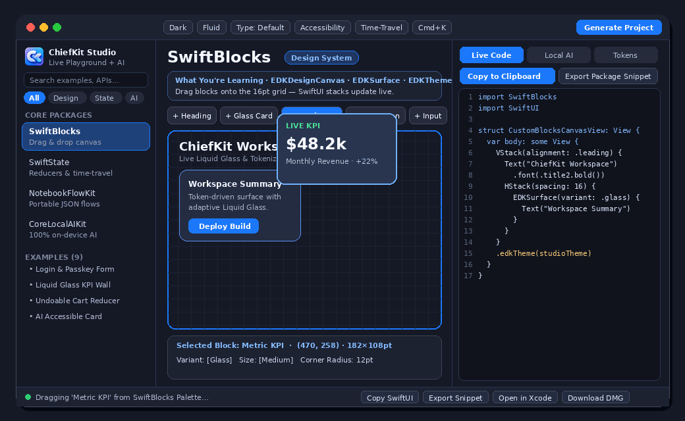

# ChiefKit Studio

**Native macOS SwiftUI Live Playground, Drag-and-Drop Canvas, Full-Stack Blueprint Composer & 100% On-Device AI Studio** for the ChiefKit ecosystem:

- [**SwiftBlocks**](https://github.com/HNMLabs/SwiftBlocks) — Interactive drag-and-drop canvas, alignment & auto-tidy grid, undo/redo, tokenized surfaces, and specular Liquid Glass
- [**SwiftState**](https://github.com/HNMLabs/SwiftState) — Predictable unidirectional reducers, async side-effects, and floating Time-Travel Debugger
- [**NotebookFlowKit**](https://github.com/HNMLabs/NotebookFlowKit) — Visual screen builder, topology graph, static flow validator, and portable JSON onboarding/quiz flows
- [**CoreLocalAIKit**](https://github.com/HNMLabs/CoreLocalAIKit) — 100% on-device Swift refactoring, VoiceOver auditing, `@Test` synthesis, and line-by-line unified diffs (zero cloud APIs, zero keys)



---

## Download & Quick Launch

- **macOS Installer (DMG):** [**Download ChiefKit Studio for macOS**](https://hnmlabs.com/downloads.php)
- **Open Directly in Xcode:** Open `Package.swift` in Xcode (or click **Open in Xcode** inside the Studio toolbar)
- **CLI Build & Run:**

```bash
./script/build_and_run.sh
```

Zero external package resolution is required to launch ChiefKit Studio — it compiles standalone out of the box on macOS 13+ using only system frameworks (`SwiftUI`, `AppKit`, `NaturalLanguage`, and optional `FoundationModels` on macOS 26+), while its cross-platform `ChiefKitStudioCore` engine builds and runs automated verification on both macOS and Linux CI.

---

## Key Capabilities

| Feature Showcase | Highlights |
| --- | --- |
|  | **Live Drag & Drop Canvas + Pro Layout Tools**<br>• Drag `SwiftBlocks` palette items onto the `16pt` snap grid or use **Auto-Craft**<br>• **Undo / Redo (`⌘Z` / `⇧⌘Z`)**, **6-Axis Alignment Bar**, **Auto-Tidy Grid**, and **Layer Lock / Reorder**<br>• **Copy to Clipboard** or **Export as Package Snippet** in one click |
|  | **CoreLocalAIKit Assistant + Live Diff + Time-Travel**<br>• 100% on-device analysis (`NaturalLanguage` + `FoundationModels`) supporting English & Turkish prompts<br>• Refactor `SwiftState`, inject VoiceOver accessibility, generate **Swift Testing (`@Test`) suites**, and inspect **colorized line diffs (`+ / -`)**<br>• Scrub backward & forward through recorded state snapshots via the floating **Time-Travel Debugger (`⌘T`)** |

### Built-In Studio 2.5 Power Tools

- **Full-Stack Architecture Composer (Blueprints):** Combine `SwiftBlocks` UI + `SwiftState` Reducer + `NotebookFlowKit` onboarding + `CoreLocalAIKit` copilot + `Swift Testing (@Test)` across 4 real-world app domains (*AI Notes Workspace*, *Fintech Treasury & Ledger*, *Developer Telemetry Cloud*, *Pulse Habit & Wellness Coach*).
- **Theme & Token Explorer + WCAG 2.1 Auto-Fix:** Live `EDKTheme` editor with real-time **WCAG 2.1 contrast auditing**, one-click **Auto-Fix AA**, and multi-format export (**SwiftBlocks `EDKTheme`**, **W3C Design Tokens JSON**, and **CSS Custom Properties**).
- **Visual Flow Builder & Topology Validator:** Author `NotebookFlowKit` screens visually or in raw JSON while inspecting transition edges and live static diagnostics (duplicate IDs, missing actions, completion terminal checks).
- **Real-Time Code Quality Scorecard:** Automatic `0–100` (`A+` → `C`) readiness scoring across *Accessibility*, *Swift 6 Concurrency*, *Token Adoption*, and *Testability*.
- **Workspace Persistence (`.chiefkit`) & Pinned Snippets:** Save/open complete studio sessions (`⌘S` / `⌘O`) and pin custom designs (`⌘D`) directly into the sidebar.
- **One-Click Project Generator (`⌘⇧E`):** Export any example, canvas, or blueprint as a complete SwiftPM / Xcode app folder with bundled `design-tokens.w3c.json` and an optional `Tests/<Target>Tests` target.
- **Preview Modes & Spotlight Command Palette (`⌘K`):** Light/Dark schemes, viewport presets (`Fluid`, `macOS 680`, `Tablet 540`, `Mobile 393`), Dynamic Type (`Small` → `AX Max`), and **Accessibility X-Ray**.

---

## Keyboard Shortcuts

| Shortcut | Action |
| --- | --- |
| `⌘K` | Open Spotlight Command Palette |
| `⌘T` | Toggle Floating SwiftState Time-Travel Debugger |
| `⌘J` | Focus CoreLocalAIKit Local AI Assistant Panel |
| `⌘Z` / `⇧⌘Z` | Undo / Redo SwiftBlocks Canvas Changes |
| `⌘D` | Pin Current SwiftUI Design to *My Pinned Snippets* |
| `⌘S` / `⌘O` | Save / Open Portable `.chiefkit` Studio Workspace |
| `⌘⇧C` | Copy Live SwiftUI Code to Clipboard |
| `⌘⇧E` | Open One-Click Xcode / SwiftPM Project Generator |

---

## Testing, CLI Self-Check & macOS Packaging

Run the full `XCTest` + Swift 6 `Testing` (`@Suite` / `@Test`) verification suites:

```bash
swift test
```

Run the end-to-end 7-subsystem diagnostic self-check or export a starter project from the CLI:

```bash
swift run ChiefKitStudio --self-check
swift run ChiefKitStudio --export-demo ./exported-demo
```

Build a release `.app` bundle and compressed DMG installer on macOS:

```bash
./script/package_macos.sh
# Output: dist/ChiefKit Studio Setup.dmg
```
