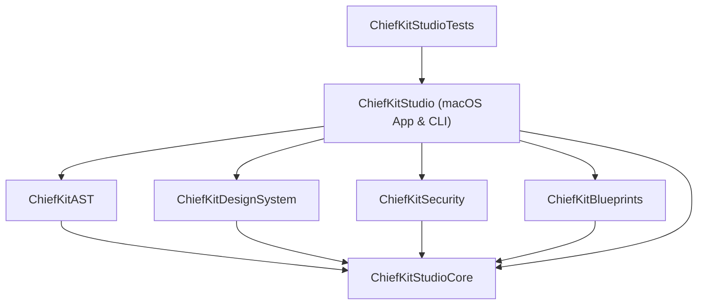

# Architecture — ChiefKit Studio 3.0 Master Suite

ChiefKit Studio 3.0 uses a **7-target modular Swift 6 architecture** (`73,872` lines across `126` Swift files) with **zero external package dependencies**:

```text
Sources/ChiefKitStudioCore/      (27 files · 14,711 lines) Cross-platform pure Swift 6 foundation
  Models/                        RGBAColor, StudioThemeTokens, CanvasDocument, FlowDefinition, BlueprintConfiguration, WorkspaceSnapshot
  Engines/                       LocalAIEngine, CodeDiffEngine (LCS), CodeQualityAnalyzer, DemoLibrary, ProjectGeneratorCore, StudioSelfCheckRunner
  DataSchema/                    EntitySchemaModels (6 ER presets, 3NF/cycle analyzer), PersistenceCodeSynthesizer (SwiftData/SQLite3 STRICT/CoreData/Actor), APISpecAndMockEngine (OpenAPI 3.1/GraphQL/Mock HTTP/URLSession)
  Localization/                  StringCatalogModels (10 locales, CLDR plurals), StringCatalogCompiler (.xcstrings codec, pseudoloc, L10n enum), StudioBuiltInTranslations
  Profiler/                      FrameBudgetProfiler (60/90/120Hz ProMotion & Flamegraphs), StateInvalidationAnalyzer (@Observable blast radius)
  Runtime/                       SwiftStateMiddlewareEngine (StudioStore actor & CausalStateDAG), NotebookFlowRuntimeEngine (predicates, Mod-97 IBAN, .ipynb), MarkdownAndDocCompiler (DocC + HTML)

Sources/ChiefKitAST/             (13 files · 11,777 lines) Swift 6 & SwiftUI Compiler Engine
  SwiftTokenModels & SwiftLexer  Nested comments, raw/multiline strings, interpolations, radix literals
  SwiftASTNodes & SwiftUIParser  Recursive-descent @ViewBuilder AST, modifiers, control flow & diagnostics
  SwiftFormatterEngine           Deterministic idempotent AST & token formatter
  ASTCanvasBridge                Bidirectional SwiftUI <-> CanvasDocument importer & exporter
  ASTStaticAnalyzer              38 rules across Concurrency, Accessibility, Tokens, Performance & Safety
  ASTTransformationEngine        6 automated AST refactoring passes (@Observable, SwiftState, A11y, Tokens, Subview, Telemetry)
  ASTMetricsAndComplexity        McCabe cyclomatic, cognitive, Halstead & maintainability metrics
  ASTTestSynthesizer             Dual Swift 6 Testing (@Suite/@Test) + XCTestCase code generator
  ASTSymbolGraphBuilder          Cross-file symbol graph, cycle detector & Mermaid exporter
  ASTSourceVerifier              Structural & directive verifier across cross-platform & macOS source trees

Sources/ChiefKitDesignSystem/    (13 files · 9,881 lines) Perceptual Color, Physics, SVG & 64 SwiftBlocks
  PerceptualColorScience         sRGB <-> CIE XYZ/LAB <-> OKLAB <-> OKLCH, APCA Lc, CIEDE2000 & 7 CVD matrices
  DesignTokenCompiler            8-target compiler (SwiftUI, AppKit, UIKit, W3C DTCG, CSS4 OKLCH, Tailwind v4, Compose, .xcassets)
  TypographyAndGridSystem        132-entry Apple HIG Dynamic Type ramp, modular scales & 8 device grids
  SpringAndAnimationPhysics      Analytical + RK4 harmonic oscillator, Newton-Raphson CubicBezier & KeyframeAnimator synthesis
  SVGPathEngine                  20-command W3C SVG parser, arc parameterizer, ear-clipping tessellator & 42 vector icons
  MultiArtboardEngine            Infinite viewport, smart snap-guides & cross-artboard symbol propagation
  AutoLayoutConstraintSolver     Deterministic 2D stack/grid layout & ASCII/SVG wireframe solver
  ComponentCatalog + 4 Suites    64 production SwiftBlocks 3.0 components across 8 categories

Sources/ChiefKitSecurity/        (11 files · 9,852 lines) Pure-Swift Cryptography, EphemerisCore & SAST
  PureSHA2Engine                 FIPS 180-4 SHA-224/256/384/512/512-256, Merkle trees & constant-time ops
  MACAndKDFEngine                RFC 2104 HMAC, RFC 5869 HKDF, RFC 8018 PBKDF2 & RFC 6238 TOTP
  ChaCha20Poly1305Engine         RFC 8439 ChaCha20, Poly1305 (2^130-5), AEAD, HChaCha20 & XChaCha20-Poly1305
  EphemerisAstronomyMath         Julian Epoch, IAU GMST/LMST, Kepler solver (<1e-12 rad) & topocentric transforms
  EphemerisPlanetaryElements     JPL J2000 9-body sky ephemerides, twilight/sunrise & lunar phases
  EphemerisEntropyProtocol       Celestial-TOTP & ChaCha20-Poly1305 location/time-bound auth envelopes
  WorkspaceVaultCrypto           .chiefkit.vault binary container + GF(2^8) Shamir k-of-n secret sharing
  StaticSecurityScanner          30 OWASP Mobile Top 10 (M1-M10) vulnerability & secret-leak rules
  ApplePrivacyManifestBuilder    PrivacyInfo.xcprivacy XML compiler/validator & Keychain/SecureEnclave actor synthesis
  SecurityAuditReportSynthesizer OWASP scorecard, threat-model Mermaid diagrams & @Test regression generator

Sources/ChiefKitBlueprints/      (13 files · 11,268 lines) 28 Enterprise Full-Stack Blueprints
  EnterpriseBlueprintModels      9 industry verticals, 28 blueprints, 8 architectural layers & 5 Apple platforms
  9 Industry Vertical Suites     Fintech, AI/DevTools, Health, Spatial Commerce, Productivity, Media, Science, SmartHome/EV, Enterprise Security
  BlueprintMultiFileExporter     14-file runnable Swift 6 SwiftPM package generator
  BlueprintArchitectureValidator Full catalog validator (FlowDefinition, brace balance, TR/EN keys, @Test coverage)

Sources/ChiefKitStudio/          (41 files · 12,146 lines) macOS SwiftUI IDE + Cross-Platform CLI
  App/                           ChiefKitStudioApp, HeadlessMain CLI & 16-subsystem MasterSuiteRunner
  Studio3Views/                  8 Studio 3.0 Workbenches + 28-Blueprint Explorer
  ViewModels/, Views/, Export/   @MainActor PlaygroundViewModel, Sidebar, Live Diff Inspector, Command Palette & Exporters

Tests/ChiefKitStudioTests/       (8 files · 4,237 lines)
  XCTest + Swift 6 @Suite/@Test  290+ test executions + static macOS SwiftUI view source verification
```

## Module Dependency Graph


